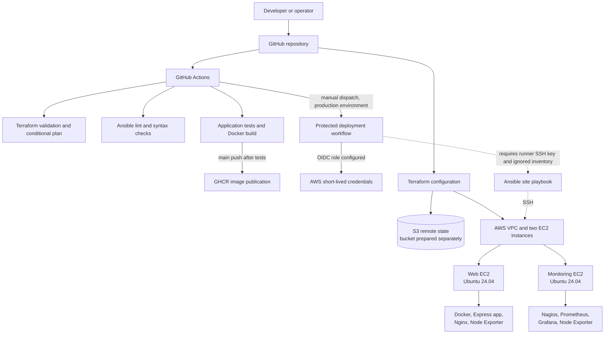
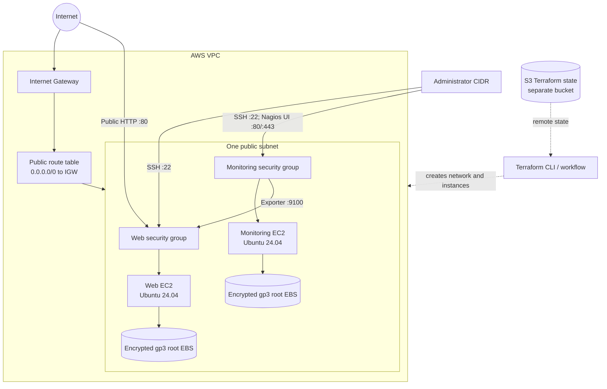
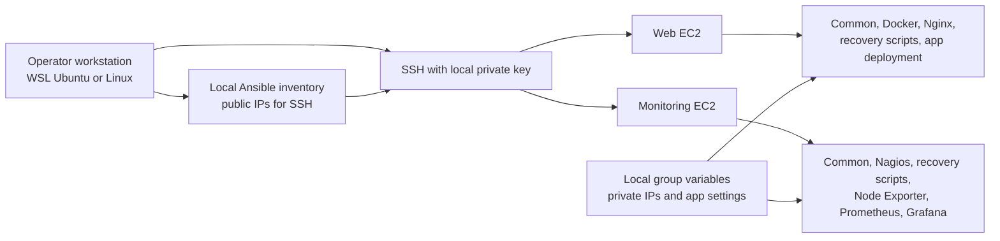
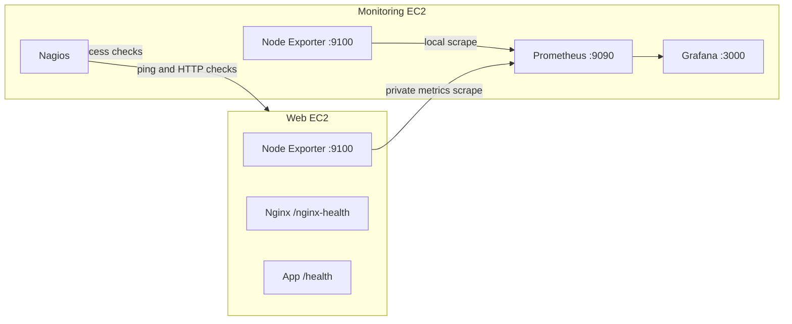
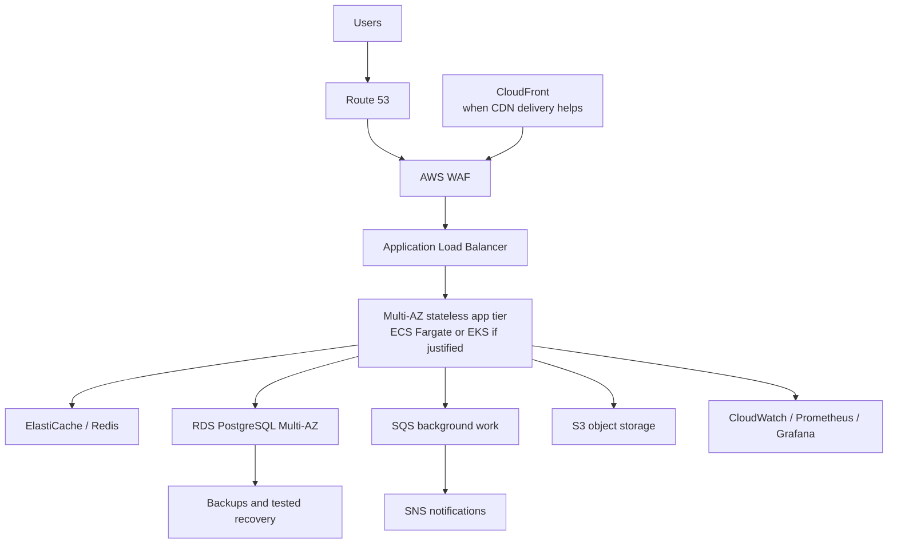

# AWS Linux Server Provisioning and Health Monitoring

An infrastructure automation project that defines two AWS Linux servers with Terraform, configures them with Ansible, runs a Node.js health application in Docker, and provides host and metrics monitoring with Nagios, Prometheus, Node Exporter, and Grafana.

> **Project status:** The repository contains the implementation and workflow configuration described below. The latest checked-in validation report records local static and application checks, but no live AWS deployment or end-to-end monitoring result is documented. GitHub workflow definitions and badges are not deployment evidence. See [verification status](#verification-status) and [limitations](#project-limitations).

## Project overview and business problem

Manually building and maintaining Linux servers involves repeating package installation, service configuration, application deployment, and health checks. Repeating those steps across machines can create configuration drift and human error. It also takes longer to deploy updates and can make service failures harder to detect.

This project brings those tasks into a repeatable workflow. Terraform describes the AWS network and compute resources, Ansible configures the two hosts, Docker packages the application, and monitoring tools check host and service health. In simple terms: Terraform prepares the servers, Ansible sets them up, Docker runs the app, and monitoring helps an operator see whether the hosts and services respond.

The repository represents configuration for a two-server demonstrator. It does not claim a live production service, an enterprise SLA, or a tested user capacity.

## Project objectives and scope

- Provision an AWS VPC, public subnet, security groups, key pair, and two Ubuntu 24.04 EC2 instances.
- Configure a web host and monitoring host using Ansible roles and playbooks.
- Run an Express health application in a Docker container, behind Nginx.
- Collect Linux metrics from both hosts and visualize them in Grafana.
- Check host reachability and HTTP service health with Nagios.
- Demonstrate GitHub Actions validation, application image publication, and a protected manual deployment workflow.

The project uses Terraform, Ansible, and Docker Compose for its current two-host scope. Kubernetes, Jenkins, an Application Load Balancer, and Auto Scaling are future options, not implemented components.

## Technology stack

| Technology | Purpose | Where it is used |
|---|---|---|
| Terraform | Declares infrastructure as code and produces plans before changes. | `terraform/` defines networking, security groups, EC2, key pair, backend, variables, and outputs. |
| AWS EC2 | Provides compute for the web and monitoring roles. | Two `aws_instance` resources in `terraform/compute.tf`. |
| AWS VPC | Isolates project network resources. | One VPC and one public subnet in `terraform/network.tf`. |
| AWS IAM | Grants AWS API access to an identity. Least-privilege roles must be configured outside the EC2 definitions. | GitHub Actions uses OIDC to assume an externally configured role in eligible jobs; Terraform does not create IAM roles or policies. |
| AWS S3 | Stores Terraform remote state and a native lock object. | Declared in `terraform/backend.tf`; the bucket must be created and secured separately. |
| AWS EBS | Provides persistent root disks for the EC2 operating systems and installed software. | Encrypted `gp3` root volumes in `terraform/compute.tf`. |
| Ansible | Configures Linux hosts over SSH using inventories, playbooks, roles, tasks, handlers, and templates. | `ansible/`. |
| Ubuntu 24.04 | Linux operating system selected from the Canonical AMI catalog. | Terraform AMI data source in `terraform/compute.tf`. |
| Docker Engine | Runs the application container. | Installed by the Ansible Docker role. |
| Docker Compose | Describes the app container, restart policy, loopback port publishing, and health check. | `docker/docker-compose.yml`. |
| Node.js and Express | Implements the health, status, and application metrics endpoints. | `app/server.js`; image uses Node.js 22 Alpine. |
| Nginx | Accepts web HTTP and reverse proxies to the app on loopback. | `ansible/roles/nginx/` and its Nginx template. |
| Prometheus | Scrapes Node Exporter metrics and evaluates rule expressions. | `monitoring/prometheus/` and the Ansible Prometheus role. |
| Node Exporter | Exposes Linux host metrics on each instance. | Ansible role `ansible/roles/node_exporter/`. |
| Grafana | Queries Prometheus and provisions a system health dashboard. | `monitoring/grafana/` and the Ansible Grafana role. |
| Nagios | Checks host reachability and web service endpoints. | `monitoring/nagios/` and the Ansible Nagios role. |
| GitHub Actions | Runs configured validation and application workflows. | `.github/workflows/`. |
| GitHub Container Registry (GHCR) | Stores application images published by the main-branch workflow. | `app-ci-cd.yml` publishes SHA and `latest` tags. |
| Bash | Provides host health, bounded recovery, and failure simulation helpers. | `scripts/`. |

## Complete system architecture

The diagram summarizes configured relationships. It does not imply that the AWS resources or services are currently running. The CI deployment workflow is manual and requires external GitHub/AWS setup and SSH inventory access; it is not an automatic Terraform-to-Ansible deployment.



### Infrastructure architecture



Terraform provisions a VPC, one public subnet, internet gateway, route table and default route, two security groups, an EC2 key pair, and exactly two EC2 instances. Both instances request automatically assigned public IP addresses. There are no `aws_eip` resources. The monitoring security group has no public ingress for Prometheus port 9090 or Grafana port 3000. Both security groups allow unrestricted outbound IPv4 egress. EBS root volumes are encrypted; S3 is for Terraform state, not EC2 disks.

### Ansible configuration workflow



Ansible uses an operator-maintained inventory and shared group variables. Terraform outputs are not automatically converted into inventory. The local inventory and group variables are ignored by Git and must not be published.

### Application deployment architecture

```mermaid
flowchart LR
    Browser[Browser] -->|HTTP :80| Nginx[Nginx on Web EC2]
    Nginx -->|reverse proxy to 127.0.0.1:3000| HostPort[Docker loopback port]
    HostPort --> Container[Docker Compose container]
    Container --> Express[Node.js 22 and Express]
    Express --> Health[/health and /api/status]
    Express --> AppMetrics[/metrics]
    Compose[Ansible deploy_app playbook] -->|pull selected app_image| Container
```

The app container is published on `127.0.0.1:3000:3000`, so clients cannot connect directly to port 3000 from the public network. Nginx listens on port 80 and proxies requests to the local container port. The app exposes `/`, `/health`, `/api/status`, and `/metrics`.

### Monitoring architecture



Prometheus is configured with 15-second scrape/evaluation intervals and rule definitions for down targets and high CPU, memory, and root filesystem use. Grafana provisions a local Prometheus data source and the system health dashboard. Nagios has ping, application HTTP, Nginx health, and process checks. Alertmanager notification routing is not configured. These are configuration definitions; target health and dashboard data have not been demonstrated in live AWS evidence.

### GitHub Actions CI/CD architecture

```mermaid
flowchart TB
    PushPR[Push or pull request] --> TF[Terraform workflow<br/>fmt, backend-free init, validate]
    PushPR --> AL[Ansible workflow<br/>lint, syntax, YAML, Bash checks]
    PushPR --> AppTest[App workflow<br/>npm ci, tests, syntax, Docker build]
    AppTest -->|push to main only| Publish[Publish SHA and latest image]
    Publish --> Registry[(GHCR)]
    Manual[workflow_dispatch<br/>immutable image input] --> Environment[production environment]
    Environment --> OIDC[AWS OIDC role assumption]
    OIDC --> AnsibleDeploy[Ansible site playbook invocation]
    AnsibleDeploy -. needs runner SSH key and ignored hosts.ini .-> Hosts[EC2 hosts]
    TF -. conditional if variables are configured .-> Plan[OIDC Terraform plan artifact]
```

The Terraform workflow does not run `apply`. The application workflow tests and builds the image, then publishes on a push to `main`. The separate deployment workflow is manually dispatched and protected by the `production` environment, but its current steps do not provision the ignored Ansible inventory or SSH key on the runner. It therefore needs remote SSH integration before its deployment path can be considered operational. A successful workflow job is not proof that Ansible configured hosts; inspect logs and verify the target hosts.

## Terraform provisioning workflow

The Terraform configuration is in `terraform/`; resources are defined directly in these files and the repository does not currently use Terraform modules:

1. Configure AWS provider region and common tags.
2. Initialize the S3 backend using separately supplied bucket settings.
3. Create a VPC, public subnet, internet gateway, and public route table.
4. Create web and monitoring security groups.
5. Register the supplied SSH public key with EC2.
6. Select a Canonical Ubuntu 24.04 amd64 AMI.
7. Create one web EC2 and one monitoring EC2 with encrypted `gp3` root disks and IMDSv2 required.
8. Output instance IDs and public/private IPs for operator configuration.

The backend block is intentionally incomplete until backend configuration is provided. The S3 bucket must be created separately and protected with public access blocking, encryption, versioning, and least-privilege IAM. Native S3 locking uses `use_lockfile = true` and requires Terraform 1.10 or newer. Do not commit backend configuration containing sensitive values, Terraform state, or plan files.

**Storage distinction:** S3 stores Terraform state; EBS stores each EC2 root filesystem; an Elastic IP would provide a stable public address but is not currently defined. Automatically assigned public IPs can change after stop/start.

From `terraform/`, validation commands do not provision infrastructure:

```bash
terraform init -backend=false
terraform fmt -check -recursive
terraform validate
```

With a real prepared backend and AWS identity, initialize and inspect a plan:

```bash
terraform init -backend-config=/secure/path/backend.hcl
terraform plan
terraform output
```

`terraform plan` reads AWS state and describes proposed changes; it does not create resources. Review every change, account, region, CIDR, instance type, and cost before any deliberate apply. If you first initialized this working directory with `-backend=false`, do not casually switch backends; follow Terraform's state migration guidance and confirm that no state could be overwritten. The GitHub workflow has validation and a conditional plan job, but no apply job.

## Ansible configuration management

Ansible configuration and playbooks live under `ansible/`. `site.yml` sequences web setup, application deployment, monitoring setup, metrics, and Grafana. Roles install packages/services and deploy configuration; handlers restart services when relevant files change. Templates use group variables for private host addresses.

Create local copies of the examples and populate them from current Terraform outputs:

```bash
cp ansible/inventory/hosts.ini.example ansible/inventory/hosts.ini
cp ansible/group_vars/all.yml.example ansible/group_vars/all.yml
```

Put public IPs in `hosts.ini` for SSH access and private IPs in `group_vars/all.yml` for monitoring/Nagios targets. Set the SSH private-key path and choose an application image. The sample addresses are placeholders. Keep both resulting files local; `.gitignore` excludes them.

Validate inventory and syntax before a remote run:

```bash
cd ansible
export ANSIBLE_CONFIG="$PWD/ansible.cfg"
ansible-galaxy collection install -r requirements.yml
ansible-inventory -i inventory/hosts.ini --list
ansible-playbook -i inventory/hosts.ini playbooks/site.yml --syntax-check
```

After checking the inventory and SSH reachability, `ansible-playbook -i inventory/hosts.ini playbooks/site.yml` applies configuration to remote hosts. It changes server state; confirm that the inventory points only to intended instances. To select an image, supply a value such as `-e app_image=ghcr.io/OWNER/aws-health-app:TAG` with the playbook command.

## Application deployment and Docker

`app/server.js` is a small Express service. `GET /health` reports `ok` and uptime, `/api/status` reports application status, `/` returns service information, and `/metrics` emits a few app-level Prometheus metrics. `app/package-lock.json` is used by `npm ci` in the CI workflow and the Docker build.

The Dockerfile uses Node.js 22 Alpine, installs locked production dependencies, runs as a non-root user, and includes a health check. Compose uses the image passed by Ansible, restarts unless stopped, and binds container port 3000 to host loopback. Ansible's `deploy_app.yml` installs the Compose template under `/opt/aws-health-app` and starts it.

On the web EC2 after configuration:

```bash
cd /opt/aws-health-app
docker compose ps
docker inspect --format '{{.State.Health.Status}}' aws-health-app
docker compose logs --tail=100 app
curl --fail http://127.0.0.1/health
curl --fail http://127.0.0.1/nginx-health
```

From a machine allowed to reach the public web endpoint:

```bash
curl --fail http://WEB_PUBLIC_IP/health
```

Replace `WEB_PUBLIC_IP` with the current Terraform output; do not publish real addresses in project documentation.

## Prometheus and Grafana

Prometheus scrapes itself and the Node Exporter endpoints on both hosts using their private addresses. Its configuration and rules are in `monitoring/prometheus/`. Grafana's data source points to `http://127.0.0.1:9090` on the monitoring instance, and its file provider loads `monitoring/grafana/system-health.json`.

On the monitoring EC2, verify service readiness and targets:

```bash
curl --fail http://127.0.0.1:9090/-/ready
curl --fail http://127.0.0.1:9090/api/v1/targets
curl --fail http://127.0.0.1:9100/metrics
```

Confirm both `node_exporter` targets are `up` in the targets response. Do not open Prometheus or Grafana to the public internet. To access Grafana through SSH forwarding, from the operator machine run:

```bash
ssh -i ~/.ssh/aws-devops-sre -L 3000:127.0.0.1:3000 ubuntu@MONITORING_PUBLIC_IP
```

Then open `http://127.0.0.1:3000` locally. This requires SSH access to the monitoring host and a locally available key. Prometheus can be tunneled similarly with local port 9090 if needed. Grafana authentication and live dashboard state must be confirmed on the deployed host.

## Nagios monitoring and checks

Nagios configuration under `monitoring/nagios/` defines both hosts and checks for ping, application `/health`, Nginx `/nginx-health`, and the Nagios process. The Ansible role installs Nagios and plugins, places these definitions, enables the configuration directory, validates configuration through a handler, and starts the service.

After deployment, verify locally on the monitoring EC2:

```bash
sudo nagios4 -v /etc/nagios4/nagios.cfg
sudo systemctl status nagios4 --no-pager
```

Access to the monitoring web server is restricted by the monitoring security group to `admin_cidr`. The exact Nagios URL and authentication depend on the installed package configuration and should be confirmed on the instance. Nagios checks are configured; no live dashboard screenshot or alert delivery evidence is included.

## AWS infrastructure components and network access

| Component | Current configuration |
|---|---|
| VPC and subnet | One VPC and one public subnet with DNS support and public IP mapping. |
| Internet gateway and route table | Default route `0.0.0.0/0` points to the Internet Gateway. |
| Web security group | SSH from `admin_cidr`, public TCP 80, ICMP ping and TCP 9100 from the monitoring security group. |
| Monitoring security group | SSH and Nagios HTTP/HTTPS from `admin_cidr`; no public Prometheus/Grafana ports. |
| EC2 instances | One Ubuntu 24.04 web instance and one Ubuntu 24.04 monitoring instance; both default to `t3.micro`. |
| EBS | Encrypted `gp3` root volume, default size 20 GiB per instance. |
| Public addresses | Automatically associated public IPv4; no Terraform-managed Elastic IP. |
| Terraform state | S3 backend declaration with native lock-file support, but bucket provisioning/security are external tasks. |
| IAM roles | No instance profile is defined in Terraform. GitHub OIDC role must be configured externally for applicable workflow jobs. |

## Project directory structure

```text
.github/workflows/       Terraform, Ansible, application and deployment workflows
ansible/                 Inventory examples, group variables, playbooks and roles
app/                     Express service, package lock and tests
docker/                  Dockerfile and Compose configuration
docs/                    Setup, architecture, audit, validation and operations guides
evidence/                Evidence guidance and incident report template
monitoring/grafana/       Provisioning and system health dashboard JSON
monitoring/nagios/        Nagios hosts, services and command definitions
monitoring/prometheus/    Scrape template and alert rules
scripts/                 Health, bounded recovery and failure simulation scripts
terraform/               AWS infrastructure, backend example, variables and outputs
```

## Prerequisites

For a Windows workstation, use Ubuntu on WSL 2 for Terraform, AWS CLI, Ansible, SSH, and Bash commands. Docker Desktop with WSL integration is useful for local image work. Install or configure:

- Git
- AWS CLI v2 and an approved AWS profile
- Terraform 1.10 or later
- Ansible and Python on WSL/Linux
- OpenSSH client and SSH agent
- Docker Engine/Desktop and Docker Compose plugin
- Node.js/npm if running app tests locally
- An AWS account, a secured S3 backend bucket, and an SSH key pair

The project audit reports which validators were available in the audited environment; it does not mean all tools are installed on every machine.

### Install tools on Windows and WSL Ubuntu

In an elevated PowerShell window, install or update WSL and Ubuntu 24.04:

```powershell
wsl --install -d Ubuntu-24.04
wsl --update
```

Restart Windows if prompted, launch Ubuntu, and create its Linux user. In the Ubuntu terminal, install common tools:

```bash
sudo apt update
sudo apt install -y ca-certificates curl gnupg wget git python3 python3-venv python3-pip pipx openssh-client unzip
```

Install Terraform from HashiCorp's signed APT repository:

```bash
wget -O - https://apt.releases.hashicorp.com/gpg | sudo gpg --dearmor -o /usr/share/keyrings/hashicorp-archive-keyring.gpg
echo "deb [arch=$(dpkg --print-architecture) signed-by=/usr/share/keyrings/hashicorp-archive-keyring.gpg] https://apt.releases.hashicorp.com $(grep -oP '(?<=UBUNTU_CODENAME=).*' /etc/os-release || lsb_release -cs) main" | sudo tee /etc/apt/sources.list.d/hashicorp.list
sudo apt update
sudo apt install -y terraform
terraform version
```

Install AWS CLI v2 using AWS's Linux installer and install the Ansible version pinned in the repository workflow:

```bash
curl -fsSL https://awscli.amazonaws.com/v2/install.sh | bash
aws --version
pipx install ansible-core==2.16.14
pipx ensurepath
export PATH="$HOME/.local/bin:$PATH"
ansible --version
```

Install the Ansible collections from the repository root:

```bash
ansible-galaxy collection install -r ansible/requirements.yml
```

Install [Docker Desktop for Windows](https://docs.docker.com/desktop/setup/install/windows-install/) with the WSL 2 backend, then enable Ubuntu under **Settings → Resources → WSL Integration**. Start Docker Desktop and check `docker version` and `docker compose version` inside WSL. For local Node.js test execution, install Node.js 22 using the [official Node.js downloads](https://nodejs.org/en/download); the application container itself uses Node.js 22. See Microsoft's [WSL install guide](https://learn.microsoft.com/en-us/windows/wsl/install/) if the WSL command is unavailable.

## AWS configuration and authentication

Use an AWS CLI profile based on your organization's approved identity flow. For AWS IAM Identity Center, a typical interactive setup is:

```bash
aws configure sso --profile devops-project
aws sso login --profile devops-project
aws --profile devops-project sts get-caller-identity
```

Confirm the returned account and role before planning. Terraform's `aws_region` variable controls the provider region. Never put access keys in the repository, README, Terraform variables, or Ansible files.

Create an SSH key if you do not already have one suitable for this project:

```bash
ssh-keygen -t ed25519 -f ~/.ssh/aws-devops-sre
chmod 600 ~/.ssh/aws-devops-sre
chmod 644 ~/.ssh/aws-devops-sre.pub
eval "$(ssh-agent -s)"
ssh-add ~/.ssh/aws-devops-sre
```

Terraform receives the public key path only. Keep the private key in WSL/Linux and do not copy it into the repository or a screenshot.

GitHub Actions uses OIDC for its configured AWS jobs when the AWS role and repository/environment configuration are present. Create and scope the IAM OIDC provider and role trust externally; pin trust to the intended repository and protected environment. No permanent AWS access keys are declared in these workflow files.

## Terraform setup and deployment steps

Clone the repository and enter it:

```bash
git clone https://github.com/uday2327/Automated-Linux-Server-Provisioning-Configuration-Management-and-Health-Monitoring.git
cd Automated-Linux-Server-Provisioning-Configuration-Management-and-Health-Monitoring
cd terraform
cp terraform.tfvars.example terraform.tfvars
```

Edit the ignored `terraform.tfvars`: set a current administrator CIDR (prefer `/32`) and the path to your SSH public key. Check instance types and region. The sample CIDR is documentation-only. Prepare `backend.hcl` outside the repository from `backend.hcl.example`, replacing the example S3 bucket/key and confirming the bucket's region and protections.

For syntax validation without AWS backend access:

```bash
terraform init -backend=false
terraform fmt -check -recursive
terraform validate
```

For a real remote-state plan, use a backend configuration and AWS profile:

```bash
export AWS_PROFILE=devops-project
terraform init -backend-config=/secure/path/backend.hcl
terraform plan
```

Review all proposed resources and changes before deciding to apply. `terraform apply` creates or changes AWS resources and may incur charges. Do not run it against an unknown or existing state. Provisioning an existing deployment should not be repeated; first identify its state, account, and resources. No apply or destroy is performed by this README update.

After intentional provisioning, use `terraform output` and fill the local Ansible inventory as described above. These outputs can contain infrastructure addresses; keep them private when sharing screenshots/logs.

## Ansible setup and execution

From repository root, make local inventory copies, then replace placeholders with current Terraform outputs:

```bash
cp ansible/inventory/hosts.ini.example ansible/inventory/hosts.ini
cp ansible/group_vars/all.yml.example ansible/group_vars/all.yml
```

Verify SSH to each host using the configured user and current public IP:

```bash
ssh -i ~/.ssh/aws-devops-sre ubuntu@WEB_PUBLIC_IP
ssh -i ~/.ssh/aws-devops-sre ubuntu@MONITORING_PUBLIC_IP
```

Then validate and execute from `ansible/`:

```bash
cd ansible
export ANSIBLE_CONFIG="$PWD/ansible.cfg"
ansible-galaxy collection install -r requirements.yml
ansible-inventory -i inventory/hosts.ini --list
ansible-playbook -i inventory/hosts.ini playbooks/site.yml --syntax-check
ansible-playbook -i inventory/hosts.ini playbooks/site.yml
```

The final command changes the selected remote machines. Check the inventory carefully first. The expected Ansible recap should list both intended hosts and report no failures; save sanitized output if you capture evidence.

## Application deployment and verification

The site playbook deploys the Compose service using the `app_image` variable configured in `ansible/group_vars/all.yml` or supplied as an extra variable. On the web host:

```bash
cd /opt/aws-health-app
docker compose pull
docker compose up -d
docker compose ps
docker inspect --format '{{.State.Health.Status}}' aws-health-app
curl --fail http://127.0.0.1/health
```

From an allowed client, verify the public Nginx route with `curl --fail http://WEB_PUBLIC_IP/health`. This endpoint is plain HTTP in the current configuration. HTTPS/TLS termination is future work.

## Useful operational commands

Commands below assume a configured host and the right access path. Run host-specific commands on the named EC2 instance.

```bash
# Web EC2: application and Nginx
sudo systemctl status nginx --no-pager
sudo nginx -t
cd /opt/aws-health-app && docker compose ps
cd /opt/aws-health-app && docker compose logs --tail=100 app
curl --fail http://127.0.0.1/health
curl --fail http://127.0.0.1/nginx-health

# Monitoring EC2: Prometheus, Grafana, Nagios and Node Exporter
sudo systemctl status prometheus grafana-server nagios4 --no-pager
sudo nagios4 -v /etc/nagios4/nagios.cfg
curl --fail http://127.0.0.1:9090/-/ready
curl --fail http://127.0.0.1:9090/api/v1/targets
curl --fail http://127.0.0.1:9100/metrics
```

The helper scripts are under `scripts/`. `health_check.sh` checks HTTP, Nginx, optional Docker health, and root disk usage. `recover_service.sh --service app|nginx` attempts bounded restarts. `simulate_failure.sh app|nginx` deliberately stops a service; use only in a safe test window and restore it afterward. These scripts were syntax checked in the recorded validation, but live recovery behavior is not established by that check.

### Stop and start EC2 instances carefully

Stopping an instance is not the same as deleting it. First confirm the correct AWS account, region, and instance ID; notify users of downtime; confirm there is no active deployment or monitoring need; and consider whether the public IP will change. Example commands:

```bash
aws --profile devops-project --region us-east-1 ec2 stop-instances --instance-ids i-REPLACE_WITH_WEB_INSTANCE_ID
aws --profile devops-project --region us-east-1 ec2 start-instances --instance-ids i-REPLACE_WITH_WEB_INSTANCE_ID
```

Use the appropriate instance ID and repeat for monitoring only if intended. Wait for the target state and verify services afterward. Auto-assigned public IPv4 addresses may change after stop/start, so refresh the local Ansible inventory. EBS storage charges continue while stopped; public IPv4 address charges can apply under current AWS pricing. These commands are examples only and were not executed.

## Troubleshooting and common errors

The repository documents static audit findings and general diagnostics. It does not include live error logs for every scenario below; causes and fixes should be confirmed against the actual command output.

| Symptom | Likely cause and response | Verification |
|---|---|---|
| Terraform says no valid credential sources | The CLI profile is not logged in, or the wrong profile is active. Authenticate to the intended profile and confirm account identity. | `aws --profile devops-project sts get-caller-identity` |
| Terraform backend bucket/access/lock error | The S3 bucket is missing, in another region, misconfigured, or inaccessible to the identity. Prepare and secure the bucket and verify least-privilege access. Do not delete a lock while another run may be active. | `terraform init -backend-config=/secure/path/backend.hcl` and inspect the error; then `terraform plan`. |
| SSH timeout or permission denied | Wrong public IP, username, key, security-group CIDR, or key permissions. Verify the instance is running and `admin_cidr` matches the current source address. | `ssh -i ~/.ssh/aws-devops-sre ubuntu@WEB_PUBLIC_IP` |
| SSH agent has no identities | The key was not added to the current WSL agent. Start an agent and add the private key. | `ssh-add -l` |
| Ansible inventory has no hosts / no hosts matched | Inventory path may be wrong, placeholders may remain, or groups may not match playbook host patterns. This must be distinguished from a successful remote run: if logs say no hosts matched or tasks were skipped, Ansible did not configure those hosts. | `ansible-inventory -i inventory/hosts.ini --list` and inspect `PLAY RECAP`. |
| Ansible variable is undefined | A required value is absent from local `group_vars/all.yml`, misspelled, or not loaded from the current working directory/config. Compare with `all.yml.example` and the task/template reference. No specific undefined-variable runtime failure is documented as having occurred. | `ansible-playbook -i inventory/hosts.ini playbooks/site.yml --syntax-check` catches some syntax issues; a real run is needed to resolve runtime variable context. |
| Ansible targets are unreachable | SSH path, key, user, host key, or security-group source is incorrect. Keep host-key checking enabled and verify each connection directly. | `ansible all -i inventory/hosts.ini -m ping` |
| Docker permission denied | The operator cannot access the Docker socket. On an EC2 host use `sudo docker ...` or configure controlled Docker access; membership in the `docker` group is effectively root-level access. | `sudo docker ps` |
| Docker image pull fails | Image tag is wrong or the host lacks GHCR read access, particularly for a private package. Confirm the immutable image exists and establish protected pull authentication. | `docker pull ghcr.io/OWNER/aws-health-app:TAG` |
| Prometheus target is down | Node Exporter may be stopped, private target IPs may be stale, or security-group access is wrong. Confirm service name and listener from the installed package before changing it. The configured role uses the Ubuntu package service `prometheus-node-exporter`; verify the actual unit on the host rather than assuming `node_exporter`. | `systemctl status prometheus-node-exporter --no-pager`; check `http://127.0.0.1:9100/metrics` on each host and Prometheus `/api/v1/targets`. |
| GitHub Actions OIDC assume-role fails | Role trust `sub`/audience, repository/environment context, role ARN, or GitHub environment variable/secret is incorrect. Limit and verify the trust policy. No AWS static-key fallback is configured. | Inspect the OIDC/configure-credentials job logs and run `aws sts get-caller-identity` only in the authenticated workflow context. |
| Deployment workflow lacks hosts or skips all hosts | The workflow invokes Ansible with `ansible/inventory/hosts.ini`, which is ignored and not generated by the current workflow steps; runner SSH key provisioning is also absent. A green workflow step that matches zero hosts must not be reported as successful remote deployment. Configure secure inventory and SSH access, then confirm the recap names both hosts and verify `/health`. | Review dispatch job logs, Ansible recap, then check `http://WEB_PUBLIC_IP/health`. |
| Grafana dashboard has no data | Prometheus may not be ready, targets may be down, or dashboard metrics may not be present. Check the data source and query results. | `curl --fail http://127.0.0.1:9090/api/v1/targets` |

The audit records that the Ansible site play initially omitted the app deployment play and monitoring target values were initially literal placeholders; those repository issues were corrected. It also records removal of an unnecessary loopback-only security group rule. These are historical code-review findings, not claims of a production incident.

## Security considerations

- **SSH:** Terraform restricts SSH ingress to `admin_cidr`; use a current, trusted narrow CIDR. Keep host-key checking enabled.
- **Security groups:** Public HTTP is permitted to the web instance. Nagios UI is limited to the admin CIDR. Node Exporter access is limited to the monitoring security group. Prometheus and Grafana ports have no public ingress.
- **IAM and OIDC:** Use least-privilege IAM policies and tightly scoped GitHub OIDC trust. Terraform does not create the role, and workflow configuration alone does not prove trust is configured.
- **Private keys:** Terraform consumes only the public key. Keep private keys in a local secure store/agent; never commit them or print them in workflow logs.
- **Terraform state:** Keep S3 private, encrypted, versioned, and access-controlled. State and plans may disclose infrastructure details.
- **EBS:** Root EBS volumes are configured encrypted. Backups and restore tests are not configured by these resources.
- **Public IPs:** Both instances receive automatically associated public IP addresses. They can change on stop/start; no Elastic IP is implemented.
- **Application:** The app port binds to loopback behind Nginx. Public web traffic uses HTTP; HTTPS certificates/TLS are not configured.
- **Operations:** Do not expose monitoring UIs or exporter ports publicly. Keep local Ansible files and real tfvars out of Git. Do not put passwords or credentials in screenshots.

For a larger environment, consider SSM Session Manager, Secrets Manager or Parameter Store, CloudTrail, AWS WAF, HTTPS/TLS, tighter security-group source references, centralized log retention, and tested backup/recovery policies. These are recommendations, not current project features.

## Cost considerations

Potential charges include EC2 runtime, EBS volumes, S3 storage/requests and retained versions, public IPv4 addresses, and data transfer. A future Elastic IP, load balancer, managed database, or managed logging/monitoring service would add costs. No exact monthly bill is claimed; region, instance types, storage, IP usage, traffic, and hours affect the total.

Stopping EC2 reduces compute runtime charges, but EBS storage continues to incur charges. AWS currently lists hourly charges for in-use and idle public IPv4 addresses; see [Amazon VPC pricing](https://aws.amazon.com/vpc/pricing/) for current details. Auto-assigned public IPv4 addresses can change after a stop/start. Review AWS pricing and budgets before provisioning.

## Scalability and future improvements

The present architecture has a single app server and a single monitoring server. Neither tier is highly available. There are no load-test results and no claim that this design can support 100,000 users. A future design would be based on measured request rate, concurrency, response times, data patterns, and cost targets.



Scale-out would require a load balancer and Auto Scaling policies, stateless app processes, database connection pooling, and possibly caching. Queues can move longer background work out of request handling. Multi-AZ design, managed secrets, centralized logs/alerts, backups, disaster recovery, and load testing address reliability and operations. Kubernetes by itself does not guarantee scalability.

| Area | Possible future addition | Capability |
|---|---|---|
| Cloud and infrastructure | ALB, Route 53, Elastic IP, Auto Scaling, CloudWatch, CloudTrail, WAF | Load distribution, naming, stable addressing where needed, scaling, AWS metrics/audit, and request filtering. |
| Container platform | ECS, Fargate, EKS, Kubernetes, Helm | Managed scheduling and deployment packaging when the operational requirements justify orchestration. |
| Infrastructure automation | Terraform modules, Terragrunt, Packer, Ansible Vault | Reuse, multi-environment orchestration, image baking, and encrypted Ansible variables. |
| CI/CD | Reusable GitHub Actions, Jenkins, Argo CD/GitOps, deployment approvals, rollback | Shared pipelines, declarative deployment, review gates, and controlled recovery. |
| Observability | Alertmanager, Loki, Grafana Alloy/Promtail, OpenTelemetry, Tempo | Notification routing, centralized logs, telemetry pipelines, and distributed traces. |
| Security | Trivy, SonarQube, Checkov, tfsec, Secrets Manager, SSM Session Manager | Image/source/IaC scans, managed secret access, and agent-based administration. |
| Reliability | EBS snapshots, AWS Backup, health-based rollback, multi-AZ | Recoverable data and fewer single-host or single-zone dependencies. |

## Project limitations

- The current deployment design uses exactly two EC2 instances and one public subnet.
- One web EC2 is a single application host; there is no load balancer or Auto Scaling.
- Public IP addresses are automatically assigned, not Terraform-managed Elastic IPs.
- The S3 backend bucket and its security configuration are external prerequisites.
- Local Ansible inventory and group variables are ignored and must be created from current Terraform outputs.
- The protected GitHub deployment workflow does not currently prepare runner-side SSH inventory or key access.
- Workflow configuration is not evidence of successful workflow execution. Inspect job logs; a run that matches no hosts is not a remote deployment.
- Prometheus/Grafana/Nagios live state, UI authentication, and alert delivery are not verified. Alertmanager is not configured.
- No Kubernetes-based high-availability architecture, load test, SLA, or 100,000-user capacity claim exists.
- HTTPS, centralized logs, automated backups, disaster recovery, and production secret management are not implemented in the current AWS configuration.

## Demo and interview explanation

### 30-second explanation

“I created a small AWS DevOps project where Terraform defines a VPC and two Ubuntu servers. Ansible configures the web and monitoring hosts, Docker runs a Node.js health app behind Nginx, and Nagios, Prometheus, Node Exporter, and Grafana provide service checks and metrics. GitHub Actions validates the code and publishes the app image. The protected deployment workflow still needs secure runner-side SSH inventory setup before remote deployment can be called verified.”

### One-minute explanation

“The project automates a small Linux environment from infrastructure through monitoring. Terraform defines a VPC, subnet, security groups, key pair, and two EC2 instances. Ansible configures Docker and Nginx on the web host and Nagios, Prometheus, Grafana, and Node Exporter on the monitoring host. The Express app has health and metrics endpoints, and Compose binds it to loopback behind Nginx. Prometheus scrapes both hosts, Grafana displays metrics, and Nagios checks reachability and HTTP health. GitHub Actions validates Terraform, Ansible, and the app, then publishes a GHCR image from main. A separate manual workflow uses OIDC, but still needs runner SSH inventory and key integration. I report configured behavior separately from live evidence.”

### Technical discussion prompts

- **Why two instances?** To separate application and monitoring responsibilities in a small demonstrator; each is still a single point of failure.
- **Why Terraform?** Infrastructure is reviewable and repeatable, and a plan shows proposed changes before applying.
- **Why Ansible?** It configures Linux hosts over SSH with reusable roles, templates, and handlers.
- **Why Docker and Compose?** They package the application and describe its container runtime, health check, restart behavior, and loopback port mapping.
- **Why Nginx?** It provides the public HTTP entry point and proxies to the app on loopback.
- **Why both Nagios and Prometheus?** Nagios checks host/service conditions; Prometheus stores time-series metrics and evaluates rules.
- **How does GitHub authenticate to AWS?** Configured jobs request an OIDC token and assume a preconfigured IAM role for short-lived credentials.
- **What is the main deployment gap?** The workflow refers to the ignored SSH inventory but does not create inventory or provision a runner SSH key; the workflow must be verified from logs and host checks.
- **How would you scale it?** Measure traffic first, then add a load balancer and horizontal app tier, address data/cache/queues, and build multi-AZ recovery and observability around explicit requirements.

## Verification status

This table summarizes checked-in validation evidence. The project audit is dated 2026-11-19; the validation reports describe local checks from different environments, and these checks were not rerun as part of the README redesign. “Implemented” means configuration/source exists, not that a remote service is healthy.

| Component | Expected state | Verification command or evidence | Current status |
|---|---|---|---|
| Terraform formatting and validation | Formatting clean; configuration validates. | `terraform fmt -check -recursive`; `terraform validate` | **Reported passed locally** in `docs/FINAL_VALIDATION_REPORT.md`; no apply. |
| AWS infrastructure | Two EC2 instances and network exist after intentional apply. | AWS console/CLI plus Terraform outputs and state | **Not verified live**; no cloud deployment recorded. |
| Ansible | Both intended hosts appear in recap with no failures. | `ansible-playbook -i inventory/hosts.ini playbooks/site.yml` and `PLAY RECAP` | **Reported syntax/lint passed**; no live remote configuration verified. |
| Application tests | Test cases pass with dependencies installed. | `npm ci && npm test` in `app/` | **Reported passed** (four tests) in `docs/FINAL_VALIDATION_REPORT.md`. |
| Docker Compose configuration | Compose YAML parses. | `docker compose -f docker/docker-compose.yml config -q` | **Reported passed**; image build/runtime not verified because Docker engine was unavailable. |
| Docker image/container | Image builds and container becomes healthy. | `docker build -f docker/Dockerfile -t aws-health-app:test .`; `docker inspect ...` | **Not verified** in the audit. |
| Application on AWS | Public Nginx route returns healthy JSON. | `curl --fail http://WEB_PUBLIC_IP/health` | **Not verified live**. |
| Prometheus and Node Exporter | Both exporter targets show `up`. | `/api/v1/targets`; local exporter `/metrics` | **Configuration present; live targets not verified**. |
| Grafana | Prometheus source and dashboard return data. | SSH tunnel and browser; inspect provisioning | **Configuration present; live UI/data not verified**. |
| Nagios | Hosts/services have expected states. | `sudo nagios4 -v /etc/nagios4/nagios.cfg`; UI | **Configuration present; live validation/UI not verified**. |
| GitHub Actions | Jobs execute as configured; published image is visible in GHCR. | Inspect actual Actions runs and package | **Workflow files present; no run evidence included in repository audit**. |
| Deployment workflow | Both hosts configured and HTTP health check succeeds. | Inspect deployment logs, recap, then `/health` | **Not verified; runner inventory and SSH integration remain outstanding**. |
| Screenshots | Genuine sanitized screenshots demonstrate actual state. | `docs/images/` or `evidence/` | **None currently present**. |

The final validation report records four application tests passing, plus YAML, JavaScript syntax, shell syntax, Compose config parsing, Terraform validation, and Ansible lint/syntax checks. The earlier Windows validation report records that its application test could not load Express because dependencies were not installed in that environment. Both reports distinguish local checks from unrun Docker engine, live AWS, remote Ansible, and monitoring checks. See [the final report](docs/FINAL_VALIDATION_REPORT.md) and [the earlier environment report](docs/validation-report.md) for command-level details.

## Screenshots and evidence

No screenshots are currently present in the repository, so this README does not reference image files that do not exist. When real evidence is captured, place sanitized screenshots under `docs/images/` or `evidence/`. Useful evidence would include EC2 instances, Terraform validation, Ansible recap, container health, app health response, Nagios checks, Prometheus targets, Grafana dashboard, and actual GitHub Actions logs. Redact account identifiers, IPs, keys, tokens, and usernames where appropriate. A green workflow badge is not a substitute for reviewing run logs.

## Final project status and checklist

- [x] Infrastructure, Ansible, application, Docker, monitoring, and workflow configuration are present.
- [x] Local validation results are documented with their date and limits.
- [x] Terraform validation/plan is distinguished from apply.
- [x] S3 state, EBS storage, and public IP roles are distinguished.
- [x] CI image publication is distinguished from remote Ansible deployment.
- [ ] Create and secure the S3 backend bucket before remote initialization.
- [ ] Review a plan in the intended AWS account and region before provisioning.
- [ ] Populate local Ansible inventory/group variables from current Terraform outputs.
- [ ] Complete and securely configure runner-side inventory and SSH for manual deployment.
- [ ] Verify app health, both Prometheus targets, Grafana panels, and Nagios checks on live hosts.
- [ ] Capture genuine sanitized evidence after those checks succeed.

## Conclusion

This repository demonstrates how infrastructure as code, configuration management, containers, CI workflows, and monitoring can fit together in a small AWS environment. It is suitable as a learning and portfolio project when its current limits are stated clearly. Complete the external backend and remote access setup, then verify each service on real instances before describing the system as deployed.

### Project documentation

- [Audit summary](DEVOPS_PROJECT_AUDIT.md)
- [Terraform guide](terraform/README.md)
- [Ansible guide](ansible/README.md)
- [Setup guide](docs/FINAL_SETUP_GUIDE.md)
- [Operations runbook](docs/FINAL_OPERATIONS_RUNBOOK.md)
- [Troubleshooting guide](docs/TROUBLESHOOTING.md)
- [Security review](docs/FINAL_SECURITY_REVIEW.md)
- [Evidence guidance](evidence/README.md)
