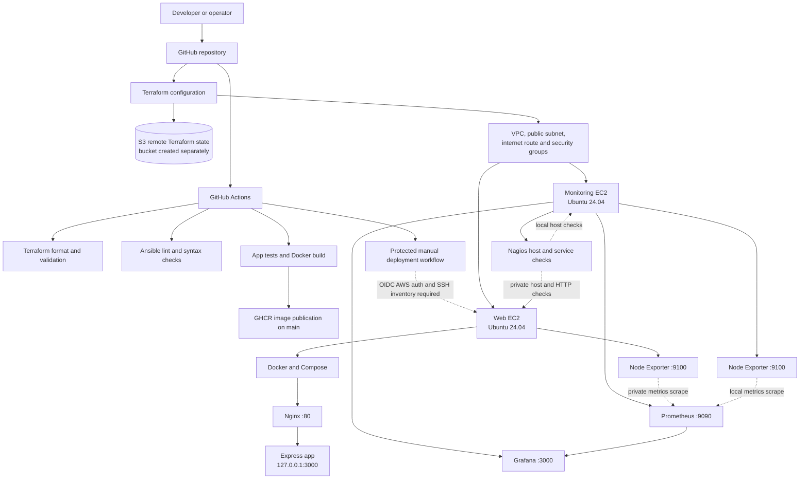
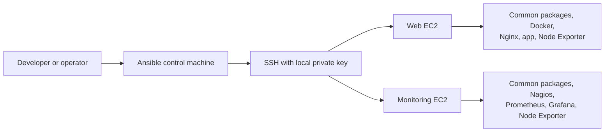
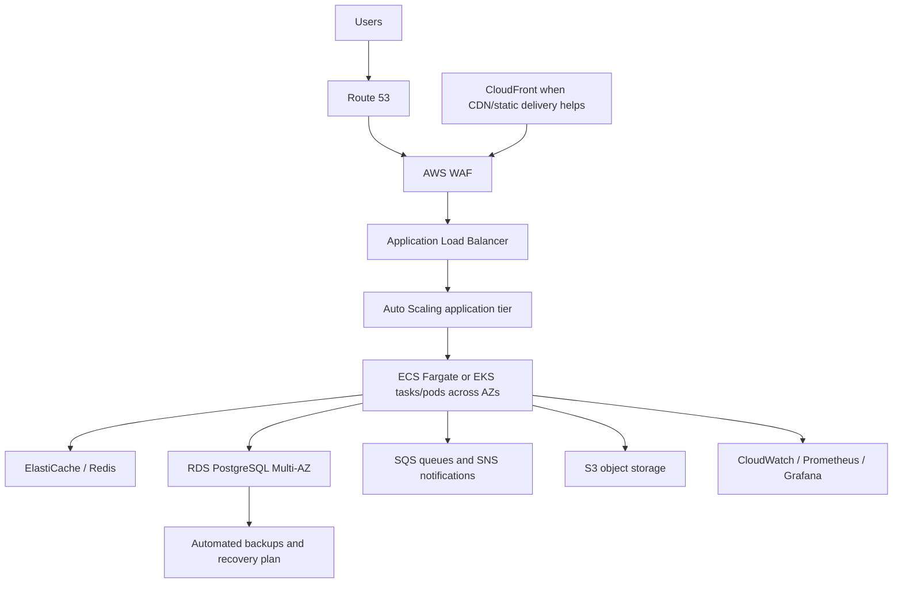

# AWS-Based Automated Linux Server Provisioning, Configuration Management and Health Monitoring System

[](https://github.com/uday2327/Automated-Linux-Server-Provisioning-Configuration-Management-and-Health-Monitoring/actions/workflows/terraform-ci.yml)
[](https://github.com/uday2327/Automated-Linux-Server-Provisioning-Configuration-Management-and-Health-Monitoring/actions/workflows/ansible-lint.yml)
[](https://github.com/uday2327/Automated-Linux-Server-Provisioning-Configuration-Management-and-Health-Monitoring/actions/workflows/app-ci-cd.yml)

This portfolio project defines a small AWS environment with Terraform, configures two Ubuntu 24.04 EC2 instances with Ansible, runs a Node.js health service in Docker, and provides host and metrics monitoring with Nagios, Prometheus, Node Exporter, and Grafana.

> **Implementation status:** This repository contains the infrastructure, automation, application, monitoring, and workflow configuration. The checked-in audit reports successful local static checks, but no live AWS deployment or end-to-end service operation has been verified. The S3 backend bucket and GitHub environment settings are external prerequisites. Review [known limitations](#known-limitations-and-roadmap) before attempting deployment.

## Contents

- [Why this project](#why-this-project)
- [Objectives](#objectives)
- [Technology stack](#technology-stack)
- [Architecture](#architecture)
- [The two EC2 servers](#the-two-ec2-servers)
- [Repository map](#repository-map)
- [Terraform infrastructure](#terraform-infrastructure)
- [Ansible configuration management](#ansible-configuration-management)
- [Application and container](#application-and-container)
- [Monitoring and recovery](#monitoring-and-recovery)
- [CI, image publication, and deployment](#ci-image-publication-and-deployment)
- [Security boundaries](#security-boundaries)
- [Getting started](#getting-started)
- [Verification](#verification)
- [Troubleshooting](#troubleshooting)
- [Screenshots and evidence](#screenshots-and-evidence)
- [Cost considerations](#cost-considerations)
- [Scaling beyond this demonstration](#scaling-beyond-this-demonstration)
- [Future tools and roadmap](#future-tools-and-roadmap)
- [How to explain this project in an interview](#how-to-explain-this-project-in-an-interview)
- [Validation record](#validation-record)
- [Conclusion](#conclusion)

## Why this project

When Linux servers are managed by hand, each machine can end up slightly different. Repeating package installation and configuration takes time, a missed step can cause an outage, deployments can be slow, and teams may not notice a failed service until a user reports it. It can also be hard to tell whether a problem is in the application or the host.

This project demonstrates a repeatable path from infrastructure definition to host configuration, application deployment, and monitoring. Terraform describes the AWS resources, Ansible configures the machines, Docker packages the app, and monitoring tools expose host and service health. A beginner can think of it as an automated recipe: Terraform prepares the two servers, Ansible sets them up, and the app and monitoring services run on them.

## Objectives

1. Describe AWS infrastructure as code.
2. Configure two Linux servers consistently.
3. Package and deploy a small health application in a container.
4. Check host and HTTP service availability.
5. Collect Linux metrics from both hosts.
6. Visualize metrics with a provisioned Grafana dashboard.
7. Demonstrate CI, container image publication, and a manually started protected deployment workflow.

## Technology stack

| Technology | Responsibility in this repository |
|---|---|
| AWS EC2 | Runs the web and monitoring workloads. |
| AWS VPC | Provides an isolated network with one public subnet. |
| AWS Security Groups | Restrict SSH and monitoring access and permit required HTTP and metrics traffic. |
| AWS EBS | Encrypted `gp3` root volumes for the EC2 operating systems and installed software. |
| AWS S3 | Configured as the Terraform remote-state backend; the bucket must be created and secured separately. |
| Terraform | Defines the network, security groups, key pair, and two EC2 instances. |
| Ansible | Applies repeatable server configuration using playbooks and roles. |
| Ubuntu 24.04 | Operating system selected by the Terraform AMI data source. |
| Docker Engine / Compose | Runs and manages the application container. |
| Node.js / Express | Application runtime and HTTP health/status/metrics endpoints. |
| Nginx | Public HTTP reverse proxy to the app on host loopback. |
| Git / GitHub | Source control and repository hosting. |
| GitHub Actions | Runs configured validation and application workflows; a separate workflow supports protected manual deployment. |
| GitHub Container Registry (GHCR) | Stores image tags published by the application workflow. |
| AWS IAM OIDC | Provides short-lived AWS credentials to configured GitHub workflow jobs; no static AWS access keys are defined in workflows. |
| Prometheus | Scrapes Node Exporter and evaluates configured alert rules. |
| Node Exporter | Exposes Linux host metrics on both EC2 instances. |
| Grafana | Queries Prometheus and provisions a system-health dashboard. |
| Nagios | Checks host reachability and web/Nginx health endpoints. |
| Bash | Health-check, recovery, and failure-simulation scripts. |

Kubernetes, Jenkins, an application load balancer, and Auto Scaling are not part of the current two-server implementation. Terraform, Ansible, Docker Compose, and GitHub Actions fit the scope of this demonstrator without adding an orchestration platform that is not yet needed.

## Architecture

The diagram describes configured relationships, not proof that the services are running. Prometheus, Grafana, and Node Exporter have no public ingress rules in the Terraform security groups. Nagios web access is restricted to `admin_cidr`.



Terraform creates the VPC, public subnet, internet route, security groups, EC2 key pair, and exactly two EC2 instances. It associates automatically assigned public IP addresses; it does not define Elastic IP resources. The S3 backend declaration expects a separately created bucket and is not self-bootstrapping.

Ansible connects to the hosts over SSH using a local inventory populated from Terraform outputs. The web play installs Docker and Nginx, then the deployment play starts the Compose application. Nginx forwards browser requests from port 80 to the app bound on `127.0.0.1:3000`. Prometheus scrapes Node Exporter on the two private IPs, Grafana reads from the local Prometheus endpoint, and Nagios checks host reachability and HTTP endpoints.

### Network and access boundaries

| Traffic | Configured access |
|---|---|
| Public browser to web server | TCP 80 to the web security group. |
| Administrator to SSH | TCP 22 from the configured `admin_cidr` on both instances. |
| Administrator to Nagios web UI | TCP 80 and 443 from `admin_cidr` on the monitoring instance. |
| Monitoring to Node Exporter | TCP 9100 from the monitoring security group to web; monitoring instance also allows same-group exporter traffic. |
| Prometheus UI (9090) / Grafana UI (3000) | No public ingress rule is defined. Use a suitable private access method such as an SSH tunnel if configured. |
| App container port | Docker publishes `127.0.0.1:3000:3000`; it is not directly exposed to the internet. |

The security groups allow outbound traffic to `0.0.0.0/0`. SSH and administrator-facing Nagios access are limited by `admin_cidr`, which must be set to a trusted current CIDR (usually `/32`).

### The two EC2 servers

```mermaid
flowchart LR
    Internet[Browser] -->|HTTP :80| Nginx[Nginx reverse proxy<br/>Web EC2]
    Nginx -->|127.0.0.1:3000| Compose[Docker Compose]
    Compose --> Express[Express app]
    Express --> Health[/health and /api/status]
    Express --> Metrics[/metrics]

    WebExporter[Web Node Exporter :9100] -. private scrape .-> Prom[Prometheus<br/>Monitoring EC2]
    MonExporter[Monitoring Node Exporter :9100] -. local scrape .-> Prom
    Prom --> Grafana[Grafana dashboard]
    Nagios[Nagios] -->|host and HTTP checks| WebEC2[Web EC2]
    Nagios -->|local checks| MonEC2[Monitoring EC2]
```

**Web EC2:** Ubuntu 24.04, Docker Engine, Docker Compose, the Node.js Express application, Nginx, recovery scripts, and Node Exporter. Browser traffic follows `Browser → port 80 → Nginx → 127.0.0.1:3000 → Express`. The loopback binding keeps direct container access off the public network; Nginx is the intended HTTP entry point. The app provides `/health`, `/api/status`, `/metrics`, and `/`.

**Monitoring EC2:** Ubuntu 24.04, Nagios, Prometheus, Grafana, recovery scripts, and Node Exporter. Prometheus scrapes Node Exporter on both machines using their private addresses. Nagios has ping, application HTTP, Nginx health, and Nagios process checks. The Prometheus and Grafana web interfaces are not opened to the internet by the Terraform security group.

## Repository map

```text
.github/workflows/       Terraform, Ansible, application, and deployment workflows
ansible/                 Inventory examples, playbooks, roles, handlers, and templates
app/                     Express application, npm lockfile, and tests
docker/                  Dockerfile and Compose service definition
docs/                    Setup, architecture, operations, security, and audit documents
evidence/                Evidence guidance and incident report template
monitoring/              Nagios, Prometheus, and Grafana configuration
scripts/                 Health check, recovery, and failure simulation scripts
terraform/               AWS network, security, EC2, backend, variables, and outputs
```

## Terraform infrastructure

The Terraform files define the following sequence:

1. Configure the AWS provider region and project tags.
2. Declare an S3 backend; supply the bucket, state key, region, encryption, and native lock-file settings separately.
3. Create a VPC, public subnet, internet gateway, route table, and default internet route.
4. Create separate web and monitoring security groups.
5. Register the operator's SSH public key as an EC2 key pair.
6. Select a Canonical Ubuntu 24.04 amd64 AMI and create one web and one monitoring EC2 instance.
7. Attach encrypted 20 GiB `gp3` root volumes by default, require IMDSv2, and tag resources.
8. Output instance IDs and public/private IP addresses for operator use.

Terraform state records the resources Terraform manages. The project uses S3 as its remote-state location, with S3 native lock files (`use_lockfile`) supported by Terraform 1.10 or later. The backend bucket is not created by this project. Before use, create it separately with public access blocked, encryption, versioning, and tightly scoped IAM access. Protect the state because it can contain infrastructure details and sensitive values. The example backend file is a template, not a configured bucket.

These AWS storage concepts are different:

| Resource | Purpose |
|---|---|
| S3 | Stores Terraform's remote state file and lock object. |
| EBS | Provides the EC2 root disk used by the operating system and installed software. |
| Elastic IP | A separately managed static public address. No `aws_eip` resource is implemented; the instances use auto-assigned public IPs. |

From the `terraform/` directory, safe preparation and validation commands are:

```bash
terraform init -backend=false
terraform fmt -check -recursive
terraform validate
```

To plan with a real AWS identity and the already prepared remote backend:

```bash
terraform init -backend-config=/secure/path/backend.hcl
terraform plan
terraform output
```

`init -backend=false`, `fmt -check`, and `validate` do not create AWS resources. `plan` queries AWS and describes proposed changes, but does not apply them. Read the entire plan, including networking and cost implications, before deciding whether to provision. `terraform apply` creates or changes resources and is intentionally not run as part of documentation work. The GitHub Terraform workflow validates and, when configured, creates a plan artifact; it has no apply step.

## Ansible configuration management

Ansible runs from a control machine (for example, Ubuntu on WSL or Linux) and connects to both EC2 hosts over SSH. Inventory identifies hosts and groups; `group_vars/all.yml` contains shared connection and application values; `site.yml` imports the web configuration, application deployment, monitoring configuration, metrics, and Grafana playbooks. Roles hold reusable tasks. Handlers restart services after relevant configuration changes, and Jinja templates insert private addresses and application settings into service configuration.



Privilege escalation uses `sudo`. The local inventory and group variables are ignored by Git and must be created and populated by the operator. Terraform outputs are not automatically converted into Ansible inventory. Review `ansible/README.md` and the setup steps below before running any play against remote hosts.

## Application and container

The Express app is intentionally small. `GET /health` returns an `ok` status and process uptime, `/api/status` returns a healthy status, `/` returns service information, and `/metrics` exposes a few application-level Prometheus metrics. The Dockerfile uses Node.js 22 Alpine, installs the locked production dependency, runs as an unprivileged user, and defines a container health check. Compose restarts the service unless stopped and binds its port to host loopback.

The Compose template takes an `app_image` value from Ansible (default example: `ghcr.io/uday2327/aws-health-app:latest`). Pin a SHA-tagged image for controlled deployment. A Docker health check reports container health; Nginx handles incoming HTTP and proxies to the local published port.

## Monitoring and recovery

| Component | Configured role |
|---|---|
| Node Exporter | Exposes operating system metrics on each EC2 host at port 9100. |
| Prometheus | Scrapes itself and both Node Exporter targets every 15 seconds; includes rules for target down, CPU, memory, and root filesystem usage. |
| Grafana | Has a provisioned Prometheus data source and system-health dashboard for CPU, memory, disk, network, uptime, and target availability. |
| Nagios | Defines host ping checks, application `/health`, Nginx `/nginx-health`, and a Nagios process check. |
| `health_check.sh` | Checks HTTP health endpoints, Nginx, optional Docker health, and root disk usage; logs results. |
| `recover_service.sh` | Makes bounded restart attempts for the app Compose service or Nginx. |
| `simulate_failure.sh` | Stops the app container or Nginx for deliberate failure demonstrations; only run in a safe test environment. |

Configuration being present does not establish that the agents, checks, dashboard, or alerts are live. Prometheus alert rules are defined, but an Alertmanager notification route is not configured. Verify targets and service health on a deployed system before treating monitoring as operational.

## CI, image publication, and deployment

The repository contains four workflow files:

| Workflow | Configured behavior |
|---|---|
| `terraform-ci.yml` | On pushes and pull requests, checks formatting, initializes without the backend, and validates. A conditional job uses GitHub OIDC to initialize the remote backend and upload a Terraform plan artifact when required repository variables are present. It does not apply. |
| `ansible-lint.yml` | Installs pinned Ansible tooling and collections, runs lint and playbook syntax checks, parses YAML, and checks shell syntax. |
| `app-ci-cd.yml` | Runs `npm ci`, tests, JavaScript syntax check, and Docker build. On a push to `main`, publishes SHA-tagged and `latest` images to GHCR. |
| `deployment.yml` | A manually dispatched workflow requiring an immutable image reference. It uses a protected `production` environment, obtains AWS credentials via OIDC, then invokes Ansible using `ansible/inventory/hosts.ini` and performs an HTTP health check. |

The manual deployment is not fully self-contained: the ignored SSH inventory and private-key access must be available to the runner, host-side image pull permissions must be set if GHCR is private, and GitHub environment/OIDC trust must be configured. The workflow does not generate inventory from Terraform outputs or configure SSH credentials in its current steps. Treat it as a configured deployment path with outstanding integration requirements, not a verified one-click deployment. Do not infer success from a workflow badge alone; inspect the job logs and health-check result.

The OIDC workflow configuration references AWS role and state settings through GitHub variables/secrets. Restrict the role trust to the intended repository/environment and scope permissions to required actions. No permanent AWS access key is embedded in the workflows.

## Security boundaries

- Set `admin_cidr` to a trusted, current administrator IPv4 range; Terraform rejects `0.0.0.0/0` for this variable.
- Web HTTP port 80 is public by design. SSH is restricted to `admin_cidr`.
- Nagios web access on monitoring port 80/443 is restricted to `admin_cidr`.
- Node Exporter ingress is restricted to the monitoring security group; Prometheus 9090 and Grafana 3000 have no public ingress rules.
- The app container binds to `127.0.0.1:3000`; Nginx is the public HTTP proxy.
- EC2 metadata requires IMDSv2, and root EBS volumes are encrypted.
- Keep private SSH keys, local Ansible inventory/group variables, Terraform state, and real `.tfvars` out of Git. The example values are not credentials or live addresses.
- Keep the S3 state bucket private, versioned, encrypted, and protected with least-privilege access.
- Configure GitHub environment branch rules and required reviewers before using its deployment workflow.

For larger environments, consider narrower security-group references, SSM Session Manager, Secrets Manager or Parameter Store, CloudTrail, HTTPS/TLS, WAF, centralized log retention, backup policies, and a documented recovery process. These are improvements to consider; they are not all implemented here.

## Getting started

This guide is for preparing a local environment. Provisioning incurs AWS charges and requires a separately reviewed plan. The current checkout's audit record is in [DEVOPS_PROJECT_AUDIT.md](DEVOPS_PROJECT_AUDIT.md), and the detailed preparation notes are in [docs/FINAL_SETUP_GUIDE.md](docs/FINAL_SETUP_GUIDE.md) and [terraform/README.md](terraform/README.md).

### Prerequisites

- AWS account and a short-lived AWS identity (such as an AWS CLI profile).
- AWS CLI v2, Terraform 1.10+, Ansible, Git, and an SSH client.
- Ubuntu/Linux workstation or Ubuntu on WSL for the Ansible control machine.
- Docker Engine/Desktop for local container work (Docker is not required just to read or validate Terraform).
- A generated SSH key pair. Terraform uses the public `.pub` key; keep the private key local.
- A secured S3 bucket prepared separately for the Terraform backend.

### Clone and inspect

```bash
git clone https://github.com/uday2327/Automated-Linux-Server-Provisioning-Configuration-Management-and-Health-Monitoring.git
cd Automated-Linux-Server-Provisioning-Configuration-Management-and-Health-Monitoring
```

Before doing anything that changes cloud resources, inspect the current repository state, configured AWS account, and Terraform plan. Do not repeat provisioning if this project already has an existing deployment; first identify the correct state and resources.

### Verify AWS identity

```bash
aws --profile devops-project sts get-caller-identity
```

Replace `devops-project` with your configured profile. Confirm the account and role are the ones intended for this project. Configure the AWS region consistently with `terraform/terraform.tfvars.example` or your chosen `aws_region`.

### Prepare Terraform inputs and remote state

```bash
cd terraform
cp terraform.tfvars.example terraform.tfvars
```

Edit the ignored local `terraform.tfvars`: set the current trusted `admin_cidr` (prefer `/32`) and the path to your SSH public key. The sample CIDR is documentation-only. Create a private backend configuration based on `backend.hcl.example`, replacing the example bucket name. The bucket must already exist; enable S3 public access blocking, encryption, versioning, and native state locking before using it. Do not put credentials in the file or commit it.

Backend-free syntax validation does not provision resources:

```bash
terraform init -backend=false
terraform fmt -check -recursive
terraform validate
```

When intentionally working with the prepared remote backend and an existing AWS identity:

```bash
terraform init -backend-config=/secure/path/backend.hcl
terraform plan
```

Review the full plan, including the two instances, public HTTP access, CIDR restrictions, and costs. These instructions do not run `apply`; provisioning is a separate operator decision after review. GitHub Actions also has no Terraform apply step.

After an approved deployment, retrieve outputs locally:

```bash
terraform output
```

Use the web and monitoring public IPs for SSH inventory entries and the private IPs for Ansible group variables and monitoring targets. Do not publish the output values if they reveal sensitive environment details.

### Prepare Ansible inventory

From repository root:

```bash
cp ansible/inventory/hosts.ini.example ansible/inventory/hosts.ini
cp ansible/group_vars/all.yml.example ansible/group_vars/all.yml
```

Replace `WEB_PUBLIC_IP` and `MONITORING_PUBLIC_IP` in the inventory with the current Terraform public IP outputs. Replace `WEB_PRIVATE_IP` and `MONITORING_PRIVATE_IP` in `all.yml` with private IP outputs. Confirm the SSH username, private key path, and `app_image`. These local files are ignored by Git. Terraform does not automatically create them.

In WSL/Linux, add the key to your SSH agent and verify access before using Ansible:

```bash
eval "$(ssh-agent -s)"
ssh-add ~/.ssh/aws-devops-sre
ssh -i ~/.ssh/aws-devops-sre ubuntu@WEB_PUBLIC_IP
```

Install the required collection, inspect inventory, and run syntax checks before a remote play:

```bash
cd ansible
export ANSIBLE_CONFIG="$PWD/ansible.cfg"
ansible-galaxy collection install -r requirements.yml
ansible-inventory -i inventory/hosts.ini --list
ansible-playbook -i inventory/hosts.ini playbooks/site.yml --syntax-check
```

Once host identity, reachability, and intended changes are confirmed, the configured playbook is `ansible-playbook -i inventory/hosts.ini playbooks/site.yml`. It changes the remote hosts; inspect the playbooks and target inventory before running. The `app_image` variable can be supplied with `-e app_image=ghcr.io/OWNER/aws-health-app:TAG` when deploying a selected published image.

## Verification

These checks are useful after a system has been deployed and configured. They do not imply that a deployment currently exists.

| What to verify | Example |
|---|---|
| Application HTTP health through Nginx | `curl --fail http://WEB_PUBLIC_IP/health` |
| App status endpoint | `curl --fail http://WEB_PUBLIC_IP/api/status` |
| Nginx direct health on web host | `curl --fail http://127.0.0.1/nginx-health` |
| Container health on web host | `docker inspect --format '{{.State.Health.Status}}' aws-health-app` |
| Compose status on web host | `cd /opt/aws-health-app && docker compose ps` |
| Ansible result | Review the final `PLAY RECAP` for both intended hosts and zero failures. |
| Node Exporter on either host | `curl --fail http://127.0.0.1:9100/metrics` from that host. |
| Prometheus readiness on monitoring host | `curl --fail http://127.0.0.1:9090/-/ready` |
| Prometheus targets on monitoring host | `curl --fail http://127.0.0.1:9090/api/v1/targets` and confirm both Node Exporter targets are `up`. |
| Grafana | Open its UI through an approved private route or SSH tunnel; confirm the Prometheus source and system-health dashboard load. |
| Nagios | Check its UI from an allowed administrator IP and confirm host/service states. |

For example, an SSH tunnel to Grafana (port 3000) or Prometheus (port 9090) can be used if SSH access is configured:

```bash
ssh -i ~/.ssh/aws-devops-sre -L 3000:127.0.0.1:3000 ubuntu@MONITORING_PUBLIC_IP
```

Then browse to `http://127.0.0.1:3000`. Nagios has administrator-CIDR-limited HTTP/HTTPS ingress in the security group. Exact UI path and authentication depend on the installed host configuration and should be confirmed on the instance.

## Troubleshooting

| Symptom | Checks |
|---|---|
| Terraform cannot find AWS credentials | Log in to the intended profile and rerun `aws --profile devops-project sts get-caller-identity`; check the provider region. |
| Backend initialization fails | Confirm the S3 bucket exists in the configured region, backend values are correct, and the identity can access the state and lock objects. Do not switch state backends casually. |
| Invalid `admin_cidr` | Use a valid IPv4 CIDR, such as your current public address with `/32`; unrestricted `0.0.0.0/0` is rejected. |
| Terraform reports unexpected replacement | Stop and inspect the plan and current state before approving any changes. |
| Ansible cannot connect | Check the public IP, Ubuntu username, key file permissions, security-group CIDR, and SSH reachability. |
| Prometheus targets are down | Confirm both Node Exporter services are active, private IPs in `all.yml` are current, and monitoring security-group ingress allows the scrape source. |
| App container is unhealthy | Check `docker compose ps`, `docker compose logs --tail=100 app`, and the container health state. Verify the app image exists and can be pulled. |
| Nginx returns an error | Check `sudo nginx -t`, `sudo systemctl status nginx --no-pager`, app health on loopback, and the Nginx upstream port. |
| Grafana panels are empty | Confirm Prometheus is ready, targets are up, the provisioned data source is reachable, and the dashboard has loaded. |
| CI deployment has no hosts or SSH failure | The workflow depends on ignored `ansible/inventory/hosts.ini` and SSH access being provisioned for the runner. These are known integration requirements; review logs and configure the mechanism before retrying. |

More command details are in [docs/TROUBLESHOOTING.md](docs/TROUBLESHOOTING.md). Do not use resource destruction as routine troubleshooting.

## Screenshots and evidence

No screenshot files are currently present in the repository. The paths below are placeholders for genuine, sanitized evidence; they are not linked as broken images. Capture actual output only after performing the corresponding check, and remove account IDs, public/private addresses, usernames, tokens, and other sensitive details where appropriate.

| Evidence requested | Suggested file when captured |
|---|---|
| AWS EC2 instances | `docs/images/aws-ec2-instances.png` |
| Terraform successful validation | `docs/images/terraform-validation.png` |
| Ansible `PLAY RECAP` | `docs/images/ansible-play-recap.png` |
| Docker healthy container | `docs/images/docker-container-health.png` |
| Application health endpoint | `docs/images/application-health.png` |
| Nagios monitoring dashboard | `docs/images/nagios-dashboard.png` |
| Prometheus targets | `docs/images/prometheus-targets.png` |
| Grafana dashboard | `docs/images/grafana-dashboard.png` |
| GitHub Actions run | `docs/images/github-actions-run.png` |

The `evidence/` directory contains guidance and an incident report template, not deployment screenshots.

## Cost considerations

Potential charges include EC2 instance runtime, EBS root volumes, S3 state storage and requests, public IPv4 addresses, and data transfer. Future additions such as Elastic IPs, an Application Load Balancer, managed databases, CloudWatch log ingestion, or other monitoring services add cost. Actual charges vary by region, instance type, storage, traffic, public IP use, and running hours; this repository makes no monthly cost estimate.

Stopping an EC2 instance can reduce compute charges, but attached EBS volumes continue to incur storage charges. S3 backend use and any retained state versions also have associated storage/request costs. Review AWS pricing for the selected region before provisioning.

## Scaling beyond this demonstration

The current design has one application EC2 and one monitoring EC2. The web server is a single point of failure and a capacity ceiling; monitoring and dashboards also depend on one host. There is no measured throughput or load test, so this project does not claim to handle 100,000 users or concurrent sessions.

A future design for a high-traffic workload could look like this:



Scaling would require measuring request concurrency, response-time objectives, database load, payload sizes, and cost budgets. Stateless application processes can scale horizontally behind a load balancer; database connection pooling and caching can reduce pressure on persistent storage. Queues such as SQS can move slow background work out of request paths, while SNS can distribute notifications. Multi-AZ placement, health-based scaling, centralized logs, secrets management, backup/restore exercises, and disaster-recovery objectives improve resilience. CloudFront is useful when static assets or cacheable delivery benefit from a CDN.

ECS/Fargate or EKS may be considered when container orchestration provides a needed operational benefit. Adding Kubernetes alone does not make an application scalable; application design, storage, database capacity, network limits, and measured demand still determine performance.

## Future tools and roadmap

| Category | Candidate | Capability it could add |
|---|---|---|
| Cloud and infrastructure | ALB, Route 53, Elastic IP, Auto Scaling | Stable naming, load distribution, stable addresses where required, and replacement/scale-out capacity. |
| Cloud and infrastructure | CloudWatch, CloudTrail, AWS WAF | AWS-native logs/metrics, API audit history, and managed web request filtering. |
| Containers | ECS, Fargate, EKS, Kubernetes, Helm | Managed container scheduling, service rollout patterns, and reusable Kubernetes packaging when operational needs justify it. |
| Infrastructure automation | Terraform modules, Terragrunt, Packer, Ansible Vault | Reusable infrastructure units, multi-environment orchestration, baked images, and encrypted Ansible values. |
| CI/CD and GitOps | Jenkins, reusable GitHub Actions, Argo CD, deployment gates, rollback | Shared pipelines, declarative continuous delivery, review controls, and safer recovery from bad releases. |
| Monitoring and observability | Alertmanager, Loki, Grafana Alloy/Promtail, OpenTelemetry, Tempo | Alert routing, centralized logs, telemetry collection, and distributed traces. |
| Security | Trivy, SonarQube, Checkov, tfsec, Secrets Manager, SSM Session Manager | Image/code/IaC scanning, managed secrets, and shell-free operational access. |
| Reliability | EBS snapshots, AWS Backup, automated recovery, health-based rollback, Multi-AZ | Recoverable data, repeatable restore procedures, and reduced dependence on a single availability zone. |

### Suggested implementation roadmap

1. Complete and verify remote Ansible inventory and SSH integration for the protected deployment workflow.
2. Add Terraform-managed Elastic IPs only after reviewing existing state and the proposed plan.
3. Add automated backups and tested snapshot/restore procedures.
4. Add centralized log collection and retention.
5. Add Alertmanager routes and tested notifications.
6. Add image, source, and infrastructure security scanning.
7. Introduce a load balancer and Auto Scaling where measured traffic needs them.
8. Evaluate ECS/Fargate or Kubernetes orchestration based on operational requirements.
9. Design multi-AZ application and data tiers with recovery objectives.
10. Load-test and tune against explicit performance and cost targets.

## Known limitations and roadmap

- The implementation is based on two EC2 instances: a single web host and a single monitoring host.
- EC2 public IPs are automatically assigned; there is no Terraform-managed Elastic IP.
- The backend block is present, but the remote S3 bucket must be created and protected separately.
- The local Ansible inventory and group variables are ignored by Git and are not generated from Terraform outputs.
- The GitHub deployment workflow expects an SSH inventory and runner SSH access that its current steps do not provision. Its remote deployment path is not verified.
- The Terraform workflow can validate and conditionally produce a plan, but does not apply infrastructure.
- The app image publication and workflow definitions do not prove that a successful GitHub Actions run or deployment occurred. Check real run logs.
- Monitoring rules and dashboards are demonstrative configuration, not an enterprise SLA. Alertmanager notifications are not configured.
- There is no Kubernetes deployment, load balancer, Auto Scaling group, multi-AZ application tier, or validated 100,000-user capacity claim.
- Nagios/Grafana authentication and live service state need verification on actual instances.

## How to explain this project in an interview

### 30-second version

“I built a small AWS DevOps project that uses Terraform to define a VPC and two Ubuntu servers. Ansible configures a web server and a monitoring server, Docker runs a Node.js health app behind Nginx, and Prometheus, Grafana, and Nagios provide metrics and service checks. I also added GitHub Actions workflows for validation and image publication, while documenting the remaining work needed for a reliable remote deployment.”

### 1-minute version

“The project demonstrates an automated path from infrastructure to monitoring. Terraform describes a VPC, a public subnet, security groups, and two EC2 instances. I use Ansible roles to install Docker, Nginx, the app, Node Exporter, Prometheus, Grafana, and Nagios. The Express app exposes health and metrics endpoints; Compose binds it to loopback, and Nginx serves HTTP on port 80. Prometheus scrapes both hosts, Grafana visualizes the metrics, and Nagios checks reachability and HTTP health. GitHub Actions validates Terraform and Ansible, tests and publishes the image, and includes a protected manual deployment workflow. I distinguish repository configuration from live proof: the AWS deployment and runner-side SSH integration still need end-to-end validation.”

### Detailed technical version

“Terraform uses the AWS provider to create the network and two Ubuntu 24.04 EC2 hosts, with encrypted EBS root disks, IMDSv2, and separate security groups. SSH and Nagios UI access are limited to an administrator CIDR; the web host accepts public HTTP, while exporter traffic is limited to the monitoring security group. Ansible uses a local SSH inventory and a sequence of playbooks to configure web, app, monitoring, metrics, and Grafana roles. Docker Compose runs an Express service bound to host loopback, and Nginx reverse proxies traffic to it. Node Exporter exposes host metrics, Prometheus scrapes both private addresses and evaluates threshold rules, Grafana provisions a data source/dashboard, and Nagios checks host and HTTP health. CI validates source and configurations and publishes GHCR images; AWS workflow authentication is designed around OIDC. The current deployment workflow still needs a secure way to provide SSH inventory and key access to the runner. I would scale by measuring workload first, then add load balancing, stateless horizontal app capacity, managed data services, caching/queues, multi-AZ recovery, and centralized observability as justified.”

### Common follow-up questions

- **Why two EC2 instances?** To separate the application workload from monitoring services in a simple demonstration. It is not highly available; each host is still a single point of failure.
- **Why Terraform instead of the AWS console?** Versioned declarative configuration makes the intended resources reviewable and repeatable, and `plan` shows proposed changes before applying.
- **Why Ansible?** It configures existing Linux hosts over SSH without requiring an agent and supports reusable roles, templates, and handlers.
- **Why Docker?** It packages the app and runtime into a consistent deployable image; Compose describes its runtime and health check.
- **Why Nginx?** It provides the public HTTP entry point and forwards traffic to the app on loopback.
- **Why both Nagios and Prometheus?** Nagios provides explicit host/service checks; Prometheus collects time-series metrics and evaluates metric rules. They answer related but different operational questions.
- **Why Grafana?** It queries Prometheus and presents host metrics in a provisioned dashboard.
- **How does GitHub Actions authenticate to AWS?** Configured AWS jobs use GitHub OIDC to assume an IAM role for short-lived credentials. Role trust and repository environment variables/secrets must be set up; no static AWS access keys are defined in the workflow.
- **What troubleshooting did the design surface?** Terraform outputs do not populate Ansible inventory automatically, and a fresh GitHub runner does not automatically have the ignored local inventory or SSH key. These integration steps must be implemented and verified rather than inferred from workflow configuration.
- **How would you scale it?** Measure traffic and bottlenecks, add a load balancer and horizontally scaled stateless app tier, then address data, caching, background work, multi-AZ availability, security, logs, and recovery. Orchestration alone is not a capacity plan.

## Validation record

The checked-in [final validation report](docs/FINAL_VALIDATION_REPORT.md) records local checks including `npm ci`, four application tests, JavaScript syntax, Terraform format/validation, Ansible syntax/lint, YAML and shell parsing. Docker engine-backed checks and live AWS, remote Ansible, and monitoring checks were not run according to that report. The report is dated 2026-11-19; check current workflow logs and rerun appropriate checks before relying on the result. Static configuration checks do not establish deployment success.

## Conclusion

This repository is a practical learning and portfolio example of connecting infrastructure as code, configuration management, containers, CI workflows, and monitoring. Its strongest demonstration is the end-to-end design and the explicit separation between configured automation and verified operation. Complete the backend, host access, protected deployment integration, and live monitoring checks before presenting it as a running AWS service.

### Further documentation

- [Project audit](DEVOPS_PROJECT_AUDIT.md)
- [Setup guide](docs/FINAL_SETUP_GUIDE.md)
- [Terraform guide](terraform/README.md)
- [Ansible guide](ansible/README.md)
- [Operations runbook](docs/FINAL_OPERATIONS_RUNBOOK.md)
- [Troubleshooting](docs/TROUBLESHOOTING.md)
- [Security review](docs/FINAL_SECURITY_REVIEW.md)
- [Evidence guidance](evidence/README.md)
